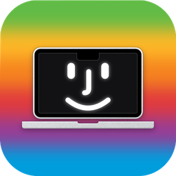

<p align="center">
  
</p>

<h1 align="center">DynamicNotch</h1>

<p align="center">
  <strong>A Dynamic Island for the Mac notch.</strong>
</p>

<p align="center">
  DynamicNotch is a native macOS app that turns the notch into a live surface for media, downloads, AirDrop, timers,
  screen recording, connectivity events, lock screen transitions, and custom hardware HUDs.
  This repository is a fork of <a href="https://github.com/jackson-storm/DynamicNotch">jackson-storm/DynamicNotch</a>.
</p>

<p align="center">
  <a href="https://github.com/nich227/DynamicNotch/releases/latest">
    
  </a>
  <a href="LICENSE">
    
  </a>
  
</p>

<p align="center">
  
  
</p>

## What it does

- Live activities include Now Playing controls, artwork, and an audio visualizer. They also include download progress, AirDrop, timers, a screen recording indicator, Focus, Personal Hotspot, and lock screen media.
- Temporary alerts cover battery charging, low battery, and full battery. They also cover Bluetooth connections, Wi-Fi, VPN, and Focus turning off.
- Gestures let you click, hover, or press and hold to expand. Swipe up to hide an activity and down to restore it.
- Motion uses spring animations that stretch and settle like the Dynamic Island on iPhone.
- On an external monitor, an iMac, a Mac mini, or an older MacBook, the app draws a floating capsule instead of a notch.

## Preview

<table align="center" cellpadding="0" cellspacing="0" width="100%">
  <tr>
    <td align="center" width="10%"><b>Compact</b></td>
    <td width="45%"></td>
    <td width="45%"></td>
  </tr>
  <tr>
    <td align="center" width="10%"><b>Expanded</b></td>
    <td width="45%"></td>
    <td width="45%"></td>
  </tr>
</table>

The gallery shows only some of the activities and alerts.

## Install

1. Download the latest DMG from the [Releases](https://github.com/nich227/DynamicNotch/releases) page.
2. Drag `DynamicNotch` into `Applications`.
3. Open the app.
4. Grant the permissions required by the features you want.

The app checks for and installs updates through Sparkle.

## Build from source

```bash
git clone https://github.com/nich227/DynamicNotch.git
cd DynamicNotch
open DynamicNotch.xcodeproj
```

Run the `DynamicNotch` scheme in Xcode. The project resolves its Swift packages.

## Releases

Pushing a tag such as `v1.0.1` runs `.github/workflows/release.yml`. The workflow builds and signs the app with a Developer ID certificate. It notarizes the app and publishes a GitHub Release with a DMG and a zip. It then adds the release to the Sparkle appcast on the `gh-pages` branch. Installed copies read this appcast.

Release notes for a version come from `docs/release-notes/<version>.md`.

### Build a signed copy on your Mac

`scripts/build-signed.sh` builds the app, signs it, and writes a zip and a disk image to `build/release`. The repository holds no credentials. The script reads the signing identity from your keychain and takes the rest from the environment:

- `CODE_SIGN_IDENTITY` names the identity. The default is the first Developer ID Application identity in the keychain. Set it to `-` for an ad-hoc signature.
- `NOTARY_PROFILE` names a notarytool keychain profile. When it is set, the script notarizes and staples the app and the disk image.

`scripts/make-dmg.sh <app> <version>` makes only the disk image, from an app that is already built.

## Acknowledgments

- This fork is based on [DynamicNotch](https://github.com/jackson-storm/DynamicNotch) by jackson-storm.
- [Lottie for iOS](https://github.com/airbnb/lottie-ios) renders the vector animations.
- [LRCLIB](https://lrclib.net) provides synchronized lyrics.
- [Lyrics.ovh](https://lyrics.ovh) is the fallback source for static lyrics.
- [mediaremote-adapter](https://github.com/ungive/mediaremote-adapter) reads Now Playing data.
- [Sparkle](https://sparkle-project.org) delivers updates.

## Legal

© 2026 Kevin Chen. Based on [DynamicNotch](https://github.com/jackson-storm/DynamicNotch), © 2025 jackson-storm.

DynamicNotch is released under the GNU General Public License v3.0. See [LICENSE](LICENSE) for details.
